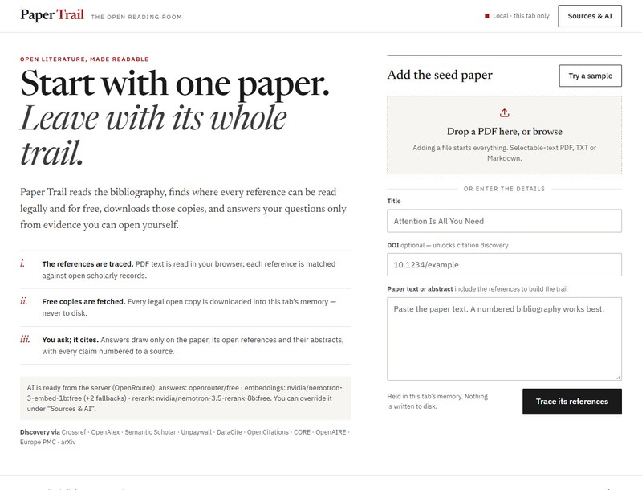
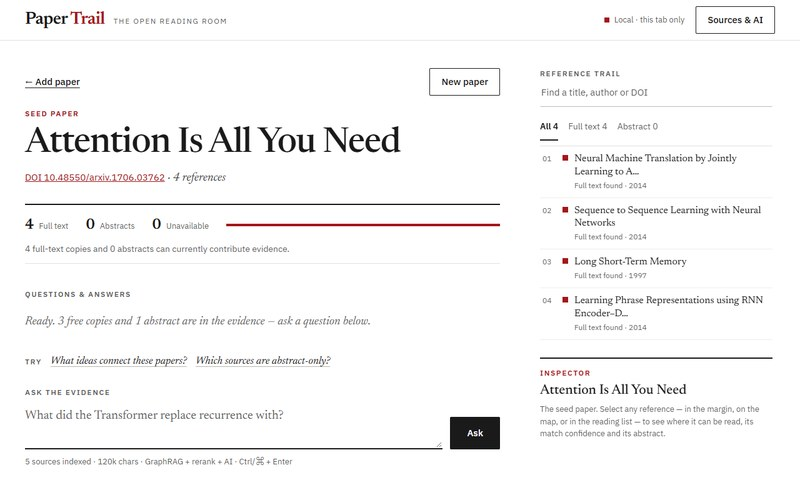
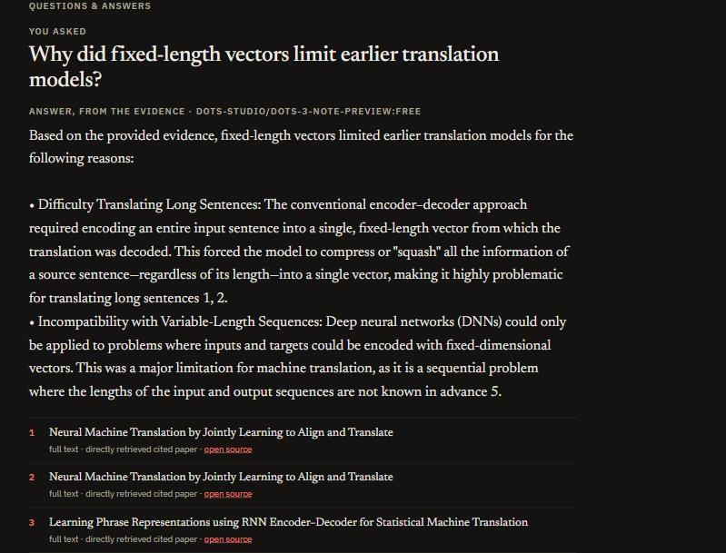
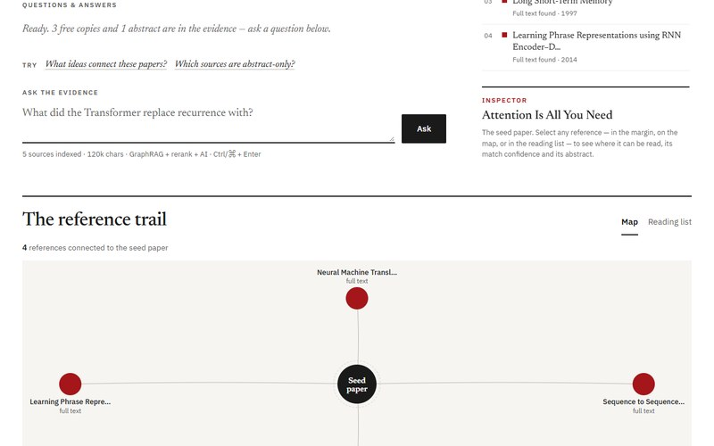

# Ctrl+V — Open research, connected

A local-first GraphRAG prototype for following a paper's references, finding openly available versions, and asking questions grounded in the paper and its cited works.

## Screenshots






## Run on Windows

1. Install Node.js 18 or newer.
2. Double-click `run.bat`, or open PowerShell in this folder and run:

   ```powershell
   node server.js
   ```

3. Open <http://127.0.0.1:8787>.

The app uses Node's built-in libraries and does not need `npm install`. Set `$env:CTRL_V_PORT = 8788` before starting to choose another local port.

## Try the demo (2 minutes)

1. Start the app (above) and open <http://127.0.0.1:8787>.
2. Click **Try a sample**, then **Trace its references**. Ctrl+V matches the four cited papers batch by batch and shows where each one can be read for free.
3. Ctrl+V then downloads every free copy it found (here, the open arXiv PDFs) and adds their full text to the evidence automatically. With an embeddings model set up, it also embeds everything in the background; the progress bar shows each stage.

4. Ask *"How does attention help with long sentences in translation?"*. The answer cites numbered sources `[1]`, `[2]`, each with a source label and link.
5. Ask *"Which sources are abstract-only?"* to see the access summary for the whole reference list.

You can also drop in your own PDF: adding a file starts everything automatically — tracing references, downloading every legal free copy into tab memory, and embedding in the background.

For AI-written answers instead of ranked passages, set up OpenRouter (below), or open **Sources & AI** and add any OpenAI-compatible embeddings and chat endpoint. A local Ollama server works without a key.

## Free AI with OpenRouter

1. Copy `.env.example` to `.env` (it is git-ignored) and paste a key from <https://openrouter.ai/keys> after `OPENROUTER_API_KEY=`.
2. Start or reload the app. No restart is needed; the server reads `.env` on each request.

The defaults are all free models:

- **Answers:** `openrouter/free`, which routes to whichever free chat model is available. The answer heading names the model that replied.
- **Embeddings:** `nvidia/nemotron-3.5-embed-8b:free`, falling back to `nvidia/nemotron-3-embed-1b:free` and then `nvidia/nemotron-3.5-embed-1b:free` when a model is down. List models comma-separated in `OPENROUTER_EMBEDDING_MODEL`; if a different model answers, Ctrl+V re-embeds the sources so vectors are never mixed.
- **Reranking:** `nvidia/nemotron-3.5-rerank-8b:free` rescores the top 30 retrieved passages before citation-graph expansion. Leave `OPENROUTER_RERANK_MODEL` empty to skip it; if reranking fails, the first-stage ranking is used.

Free models change over time, so update the names in `.env` if one is retired.

The key stays on the local server and is never sent to the browser. Anything filled in under **Sources & AI** overrides these defaults for that tab. Free OpenRouter models allow 50 requests a day for accounts that have never bought credits (1,000 a day after buying at least 10 credits), and a question uses about 2–4 requests. Some free providers may keep prompts for training; Ctrl+V sends them only public paper text and your question.

Demo video: _add link_

## Use it

1. Upload a selectable-text PDF, paste the paper text or abstract, or enter a title or DOI.
2. Ctrl+V extracts the reference section when present. If the paper has a DOI but no bibliography text, it can discover references from Semantic Scholar and OpenCitations.
3. The local server resolves reference metadata and checks for open locations. Add an Unpaywall email in **Sources & AI** for DOI-based Unpaywall lookups. A CORE key is optional.
4. Review the citation map, source status, match confidence, version, and license when those details are available.
5. Ctrl+V downloads every discovered free copy (PDF, XML, HTML or text) into the current tab, three at a time, trying up to three locations for each. A reference whose copy could not be read shows **Retry download**. Abstracts are available for retrieval as soon as metadata is found.
6. With free OpenRouter models set in `.env` (see `.env.example`), or any OpenAI-compatible endpoint under **Sources & AI**, Ctrl+V embeds the current paper and reference text in memory in the background (128 passages per request), then uses semantic similarity plus citation-graph expansion. An optional chat model synthesizes the retrieved evidence; without one, Ctrl+V returns ranked passages.

## GraphRAG approach

The prototype represents the uploaded paper as the seed node and its references as citation-linked nodes. With an embeddings endpoint configured, it creates vectors for source passages and the question, ranks by cosine similarity with a lexical relevance signal, starts from the strongest matching nodes, then expands through the citation graph before presenting evidence. If embeddings are unavailable, it falls back to lexical passage ranking. The current graph covers the seed paper and its direct references; it does not discover a deeper literature graph yet.

Every answer keeps a source label and link. Abstract-only evidence is labeled as such, and the optional model prompt requires inline source citations and an explicit statement when the available evidence is insufficient.

## Discovery services

- **Crossref** for DOI and publication metadata.
- **DataCite** as a metadata fallback for DOIs registered outside Crossref.
- **OpenAlex** and **Semantic Scholar** for title/DOI matching, abstracts, citation data, and OA locations.
- **Unpaywall** for DOI-based open-access locations. Its search endpoint was retired in September 2026; Ctrl+V uses its DOI endpoint and relies on OpenAlex or Semantic Scholar for title search.
- **CORE** and **OpenAIRE** for repository discovery; CORE requires a user-provided API key in this prototype.
- **Europe PMC** and **arXiv** for subject-specific records and open full text when applicable.
- **OpenCitations** to supplement the paper's reference edges when DOI citation data is available.

Discovery and indexing are best-effort. Providers can be unavailable, miss a repository copy, return stale links, or disagree on a match. Check the displayed title, authors, year, DOI, source host, version, and license before relying on a result. An open URL does not by itself grant permission to redistribute or reuse the work; the rights of the specific item apply. Ctrl+V does not bypass paywalls.

## Data handling

- Uploaded PDFs are parsed in the browser through PDF.js loaded from the CDN; scanned PDFs without selectable text need OCR elsewhere or pasted text.
- The local server binds only to `127.0.0.1`. Paper contents and extracted full text are held in the current tab's memory and are not written to disk by this app.
- Reference titles and DOIs are sent to the configured scholarly discovery APIs. The app does not send the whole uploaded paper to those metadata APIs.
- If an embeddings endpoint is configured, source chunks and each question are sent there to create vectors. If a chat model is configured, the question and retrieved passages are also sent to that endpoint for synthesis. API credentials are held in page memory and are not persisted by Ctrl+V.
- Free copies are downloaded automatically after references are traced, into this tab's memory only; nothing is saved to disk. The server fetches each one in memory, permits only HTTPS public hosts, caps the download at 18 MB, and returns extracted text to the browser.

## Current prototype limits

- Reference parsing works best with a clearly labeled, numbered bibliography; unusual layouts may need manual paste or correction.
- PDF parsing requires selectable text. OCR is not included.
- Citation matching is metadata-based and may need human confirmation.
- Full-text indexing supports PDF, XML, HTML, and plain text; scanned PDFs, publisher anti-bot pages, and unstable repository links may fail.
- The graph is currently one paper plus its direct references. The UI shows citation relationships, not proof that linked papers agree.

## License

MIT — see [LICENSE](LICENSE).
